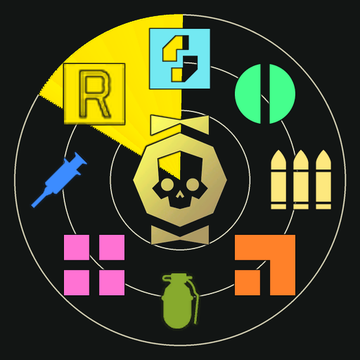

# Awmer Treasure Radar

An unofficial Helldivers 2 mod that puts loot, objectives and enemy structures on the game's own map, with a small radar, compass pips and world pins while the map is closed.

It is a fork of [Treasure Radar](https://github.com/Th3chef/Treasure-Radar) by **Th3chef**, who made the original mod and the Chef Loader this one boots from. This is not an official Treasure Radar release, so please send bug reports for it here and not to Th3chef.



## What it does

**On the map (Tab)**

- Icons for Super Credits, Medals, Common, Rare and Super Samples, Requisition Slips, ammo, grenades and stims
- Icons for objectives, side objectives, nests, enemy structures, caches, points of interest and extraction
- Works at all three map zoom levels; the two closer zooms use a small helper program ([details below](#the-closer-zooms-helper))
- A legend beside the map that counts what's left of each type
- The game's own icons, except for side objectives, which have a drawn icon

**With the map closed**

- A small radar in the corner, turning with you or with north up
- The nearest valuables on the game's compass
- Pins over loot near you, showing the icon and distance
- A waypoint of your own on whatever you're looking at

Everything is on by default. Tick the mod and play.

## Install

1. Install [HD2ModManager](https://github.com/teutinsa/Helldivers2ModManager) if you don't have it.
2. Download `Awmer-Treasure-Radar-1.0.0.zip` from [Releases](../../releases).
3. Add the zip in the manager without unpacking it, tick **Awmer Treasure Radar**, and deploy.
4. Play the game in **borderless** mode if you want icons at the closer zooms.

Remove other Treasure Radar builds first. This mod has its own loader built in, so it can't run alongside another mod that replaces the game's boot script, such as Chef Shared Loader or mods that need it.

## Keys

| Key | What it does |
|---|---|
| F7 | Hide or show the mod |
| Numpad 1 | Set or clear a waypoint on what you're looking at |
| Numpad 3 | Clear your waypoints |

## Options

All of these are in the mod manager. If you don't change anything, you get the defaults.

| Option | Choices |
|---|---|
| Outside the Map | **Radar, compass pips and pins**; compass pips and pins only; nothing |
| Legend | **While the map is open**; always; off |
| Loot and Map boxes | Tick the types you want. With no box ticked in a group, that whole group shows |
| Corner Radar Size | **Medium**; large; small |
| Radar Facing | **Turns with me**; north up |
| World Pins | **50 m**; 25 m; 100 m; off |
| Panel Opacity | The game's own HUD setting, or 100, 75, 50 or 25% |
| Map Icon Opacity | **100%**; 75, 50 or 25% |
| World Pin Opacity | **100%**; 75, 50 or 25% |
| Closer Zooms Helper | **Start it with the game**; off (whole map only) |

## The closer zooms helper

The zip includes `TreasureRadarCompanion.exe`, about 60 KB. **By default, the mod starts it when the game starts.** You can turn this off with the **Closer Zooms Helper** option.

**Why it's needed:** when the map is fully zoomed out, a Lua mod can work out exactly where every icon goes. At the two closer zooms, the map centres on a cursor whose position the game doesn't share with mods. The helper finds that position by looking at the map on screen.

**What it does:**

- While the map is open, it captures only the map circle from the game's window and keeps those pixels in memory.
- It writes the map position to a small text file in `%LOCALAPPDATA%\Temp`, where the mod reads it.
- It also writes a log to that folder. The log contains the folder path, which includes your Windows user name. Check it before you share it.
- It exits when the game closes.

**What it doesn't do:** it has no network code, doesn't read or write game memory, doesn't inject code, doesn't send input, and doesn't need admin rights.

**Without the helper:** the icons on the fully zoomed-out map still work and are just as exact. Icons don't show at the two closer zooms.

### Things you should know first

- **Anti-cheat:** Helldivers 2 runs Easy Anti-Cheat, and nobody can promise how it will treat a mod or a program that captures part of the screen. The helper uses the same plain Windows capture call as screenshot tools. If that's a risk you don't want, turn the helper off, or don't use the mod. You use it at your own risk.
- **Windows warning:** the exe isn't code-signed, so SmartScreen or your antivirus may flag it.
- **Key settings:** the mod itself, not the helper, reads the game's `input_settings.config` from your Steam `userdata` folder to learn your key bindings, and Steam's `loginusers.vdf` to find that folder. It doesn't change either file or send anything anywhere.
- **Check the exe:** this is its SHA-256:

  ```
  3E9FEAA07A533A4B72EBAB910FC15AFC7BD858C321BEC1167EAB48BCC1B85A99
  ```

  To compare the exe with the source, run `dev\companion_cs\verify_build.ps1`. [dev/companion_cs/README.md](dev/companion_cs/README.md) explains how, and has the full list of what the helper reads and writes.

## Known limits

- **Closer zooms:** icons hide while you move the map and come back when you stop.
- **After opening the map:** if the mod isn't sure of the zoom level yet, it briefly draws icons as if the map were fully zoomed out. They can be misplaced until it catches up.
- **Exclusive fullscreen:** the helper can't capture it, so use borderless.
- **Testing:** version 1.0.0 passes the simulated test suite, but it hasn't had a long run in real missions yet. Bug reports are welcome. Please include `treasure_radar.log` from `%LOCALAPPDATA%` and remove anything personal first.
- **Icon choices:** some map icons (extraction, silo, tower, outpost, nest, check and cross) are game art picked by eye and may not be what the game's own map uses for those things. [SOURCES.txt](dev/src/art/game_icons/SOURCES.txt) lists each one.

## Build from source

You need Windows and Python 3 with Pillow (`pip install pillow`). The helper builds with the C# compiler included in Windows.

```bash
dev\companion_cs\build.cmd
```

```bash
python dev/tools/build.py dev/tools/builds/1.0.0.json
```

The output goes to `dev/build/Treasure-Radar-1.0.0`. To make an installable mod, zip that folder's contents with `manifest.json` at the top level of the zip.

To run the simulated missions without the game, see [dev/harness/README.md](dev/harness/README.md).

## Credits

- **[Th3chef](https://github.com/Th3chef/Treasure-Radar):** the original Treasure Radar and the Chef Loader. Parts of their code are still in this mod. Th3chef gave permission on 2 November 2026 to use Treasure Radar as a base, credited with a link.
- **[filediver](https://beta.pkg.go.dev/github.com/xypwn/filediver):** its list of game file names helped identify icons.
- **Arrowhead Game Studios and Sony Interactive Entertainment:** Helldivers 2 and its icons.

## License

This repo has more than one license: see [LICENSE](LICENSE) and [NOTICE.md](NOTICE.md).

- **Awmer's own code, art and tools:** MIT
- **Th3chef's loader and adapted code:** Th3chef's terms, not MIT
- **Helldivers 2 icons and names:** belong to their owners, not licensed here

This is a fan project and isn't affiliated with or endorsed by Arrowhead Game Studios or Sony Interactive Entertainment.
